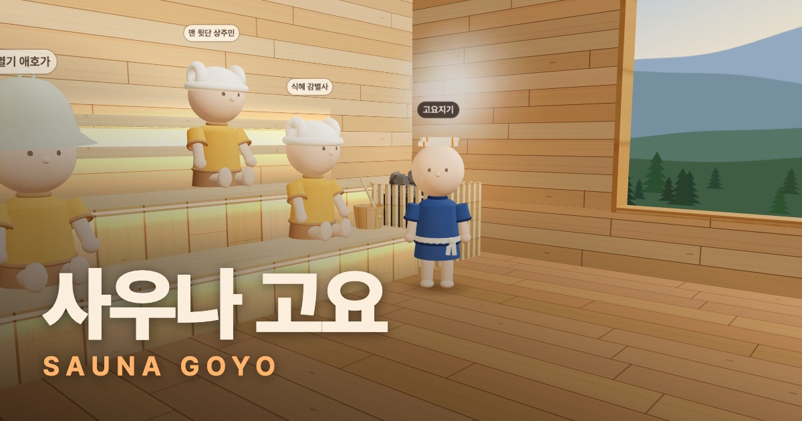

# 사우나 고요 (SAUNA GOYO)

> **안내** 사우나 고요는 실제 운영 중인 서비스입니다. 운영 보안을 위해 소스 코드와 운영 문서는 공개하지 않고, 이 저장소에는 서비스 소개 문서만 공개합니다.

> 일상에 지친 당신에게 잠깐의 고요를.

말없이 같이 땀 빼고 쉬어 가는 3D 온라인 사우나입니다. 브라우저에서 바로 들어와, 다른 손님과 같은 공간에 머물며 사우나 → 냉탕 → 외기욕으로 이어지는 '토토노우' 루틴을 천천히 따라갈 수 있습니다.

- 사이트: https://saunagoyo.com

## 무엇을 할 수 있나요

| 공간 | 하는 일 |
|---|---|
| 건식 사우나 | 벤치에 앉아 땀 빼기, 달궈진 돌에 물 붓기(뢰일리) |
| 냉탕 | 몸 식히기 |
| 외기욕 쉼터 | 앉거나 누워서 쉬기 |
| 목욕탕 · 노천탕 | 몸 담그고 쉬기, 노천탕은 낮과 밤 전환 |
| 고요 카페 | 음료·간식 주문해 들고 마시기, 카페 고양이 쓰다듬기 |

- **같이, 그러나 조용히**: 다른 손님의 위치·자세·자리·머리 장식이 실시간으로 보입니다. 채팅 대신 인사 동작만 있습니다.
- **고요지기**: 공간마다 한 명씩 있는 안내 캐릭터입니다. 혼자 들어와도 비어 있지 않습니다.
- **자동 닉네임**: 들어올 때마다 "식혜 감별사" 같은 이름이 정해져 붙습니다. 이름을 직접 입력하지 않습니다.
- **숨 고르기**: 화면 안내에 맞춰 천천히 호흡하는 짧은 쉼 기능입니다.
- **머리 장식**: 양머리, 사우나 햇, 터번 수건 중에서 골라 꾸밀 수 있습니다.
- **소리**: 돌 위로 물 붓는 소리, 물 흐르는 소리, 바람, 새소리, 풀벌레 소리 등 공간마다 다른 배경음이 있고, 소리 크기를 조절할 수 있습니다.
- PC(키보드·마우스)와 휴대폰(터치) 모두 지원합니다.

## 만든 방식

- **3D 화면**: three.js. 텍스처, 벽화, 풍경, 캐릭터를 외부 에셋 없이 모두 코드로 그립니다.
- **소리**: Web Audio API로 직접 합성합니다. 새소리와 풀벌레 소리만 녹음 파일(CC0, CC BY 4.0)을 씁니다.
- **실시간 접속**: Cloudflare Workers + Durable Objects(WebSocket). 손님을 여러 채널로 나누어 받습니다.
- **빌드와 배포**: Vite, Vercel.
- **방문 통계**: Vercel Web Analytics로 방문 통계(본 페이지, 기기 종류, 대략적인 지역)와 숨 고르기 사용 횟수를 익명 집계합니다. 닉네임이나 채널 번호는 보내지 않고, 쿠키는 쓰지 않습니다.

## 문서

- [slides/index.html](slides/index.html): 발표자료 "AI로 4시간 만에 출시하고, 실제 이용자를 만나기까지" (내려받아 브라우저로 열기)
- [THIRD_PARTY_NOTICES.md](THIRD_PARTY_NOTICES.md): 사용한 오픈소스와 녹음 소리의 라이선스 고지
- [docs/ios-screen-recording-audio-crackle.md](docs/ios-screen-recording-audio-crackle.md): iOS 브라우저 화면녹화 시 소리가 지직거리는 현상 조사 기록
